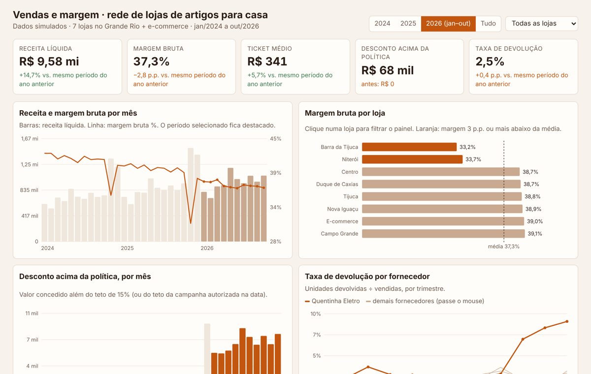

# Receita sobe, margem cai: onde está o vazamento?

Análise de vendas de uma rede fictícia de lojas de artigos para casa no Grande Rio (7 lojas físicas e e-commerce, janeiro de 2024 a outubro de 2026). O projeto usa Python, SQL e Power BI, e o caminho é o mesmo que eu usaria numa empresa: limpar a base do ERP, responder às perguntas da gestão em SQL e entregar um painel.

**Painel interativo:** https://leticiacerqueira.github.io/painel-vendas/ · **Power BI:** pasta [`powerbi/`](powerbi/)



> Os dados são simulados, porque bases de vendas reais são confidenciais. Eles foram gerados com problemas que aparecem na prática (pedidos duplicados pela integração, código de loja fora do padrão, categorias escritas de jeitos diferentes, preço zero, ano digitado errado e produtos sem custo) e com uma história escondida para a análise encontrar.

## A pergunta
De janeiro a outubro de 2026, a receita cresceu 14,7% em relação ao mesmo período de 2025, mas a margem bruta caiu de 40,1% para 37,3%. **O que explica a queda, e o que fazer?**

## O que os dados mostram
1. **Dois terços da queda (−1,8 p.p.) vêm de um desconto que não foi desligado.** A campanha "Semana do Eletro" (20% em eletroportáteis) terminou em 23/11/2025, mas a regra continuou ativa nos caixas da Barra da Tijuca e de Niterói. Em 2026, 88% dos eletroportáteis dessas duas lojas saíram com 20% de desconto: o desconto médio da categoria ficou em 17,9%, contra 2,8% nas outras lojas. A margem de eletroportáteis nelas caiu para 15,5% (28,5% nas demais lojas). São cerca de **R$ 168 mil de margem perdida em dez meses**, R$ 68 mil só no que passou do teto de 15% da política.
2. **Um terço (−1,0 p.p.) é mix de produtos.** Eletroportáteis, a categoria de menor margem, subiram de 44% para 49% da receita. Não é um erro, mas a meta de margem precisa considerar esse mix.
3. **Um fornecedor começou a dar defeito.** As fritadeiras da Quentinha Eletro passaram de cerca de 2% para 8% a 9% de devolução a partir de março de 2026, e 85% delas por defeito. Foram R$ 132 mil estornados e R$ 96 mil de custo em produto defeituoso para negociar com o fornecedor.

**Recomendações:** desligar a regra nos caixas e criar um alerta diário de desconto acima do teto; acionar o fornecedor e segurar o lote das fritadeiras; acompanhar a margem por categoria, e não só a margem total.

## Etapas
| Etapa | Script | O que faz |
|---|---|---|
| 1 | `src/01_gerar_dados.py` | Gera os arquivos brutos do ERP em `dados/brutos/` |
| 2 | `src/02_limpeza.py` | Limpa e padroniza, carrega o SQLite e grava o log em `saida/log_limpeza.csv` |
| 3 | `sql/analises.sql` + `src/03_consultas_sql.py` | 8 perguntas em SQL; cada resultado vira um CSV em `saida/sql/` |
| 4 | `src/04_painel_html.py` | Gera o painel interativo em `painel/index.html` |
| 5 | `src/05_exportar_powerbi.py` + `powerbi/gerar_pbip.py` | Modelo estrela para o Power BI e o projeto PBIP com 3 páginas |

```bash
pip install pandas numpy
python src/01_gerar_dados.py && python src/02_limpeza.py && python src/03_consultas_sql.py
python src/04_painel_html.py && python src/05_exportar_powerbi.py && python powerbi/gerar_pbip.py
```

## Limpeza dos dados
| Problema | Linhas | Ação |
|---|---|---|
| Itens duplicados (a integração do e-commerce reenviou pedidos) | 601 | removidos |
| Código de loja fora do padrão (`L4`) | 140 | corrigido para `L04` |
| Quantidade negativa (estorno lançado como venda) | 23 | removidos (a devolução já está na tabela de devoluções) |
| Preço zero | 41 | marcados e fora da receita |
| Ano digitado errado (2052) | 2 | corrigido para 2025 |
| Categoria com 11 grafias para 6 categorias | 15 produtos | padronizado |
| Produto sem custo cadastrado | 6 produtos (3.895 itens) | receita mantida, fora do cálculo de margem |

## SQL
As consultas em [`sql/analises.sql`](sql/analises.sql) usam CTEs, `CASE`, junção por intervalo de datas (campanha válida na data da venda) e window functions (`LAG` para comparar com 12 meses antes, soma acumulada para a curva ABC e `RANK` para o ranking de metas).

| Consulta | Pergunta |
|---|---|
| `01_receita_margem_mensal` | Como receita, margem e ticket evoluem contra o mesmo mês do ano anterior? |
| `02_margem_por_loja` | Quais lojas perderam margem de 2025 para 2026? |
| `03_desconto_fora_politica` | Onde houve desconto acima do teto sem campanha autorizada? |
| `04_desconto_excedente_por_loja` | Quanto de desconto passou do limite, por loja e ano? |
| `05_devolucao_por_fornecedor` | Qual fornecedor tem devolução fora do normal? |
| `06_curva_abc_margem` | Quais produtos fazem 80% da margem? |
| `07_meta_por_loja_2026` | Quem bateu a meta de receita em 2026? |
| `08_ponte_margem_2025_2026` | A queda é de mix ou de margem dentro da categoria? |

## Power BI
A pasta [`powerbi/Painel Vendas/`](powerbi/Painel%20Vendas/) é um projeto do Power BI (PBIP) que lê os CSVs de `saida/powerbi/` direto deste repositório. Tem 3 páginas (Visão Geral, Margem e Descontos, Devoluções), filtros de loja e período e medidas DAX como margem %, variação contra o ano anterior (`SAMEPERIODLASTYEAR`), ticket médio, desconto acima da política e taxa de devolução.

Para abrir: baixe a pasta, abra `Painel Vendas.pbip` no Power BI Desktop e clique em **Atualizar** (se pedir credencial, escolha **Anônimo**).

---
Leticia Cerqueira · [portfólio](https://leticiacerqueira.github.io) · [LinkedIn](https://www.linkedin.com/in/leticiasantoscerqueira/)
